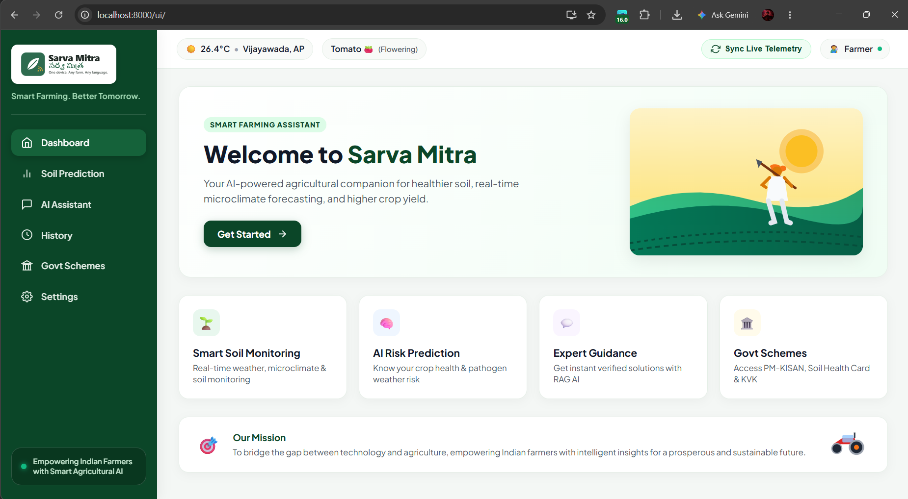
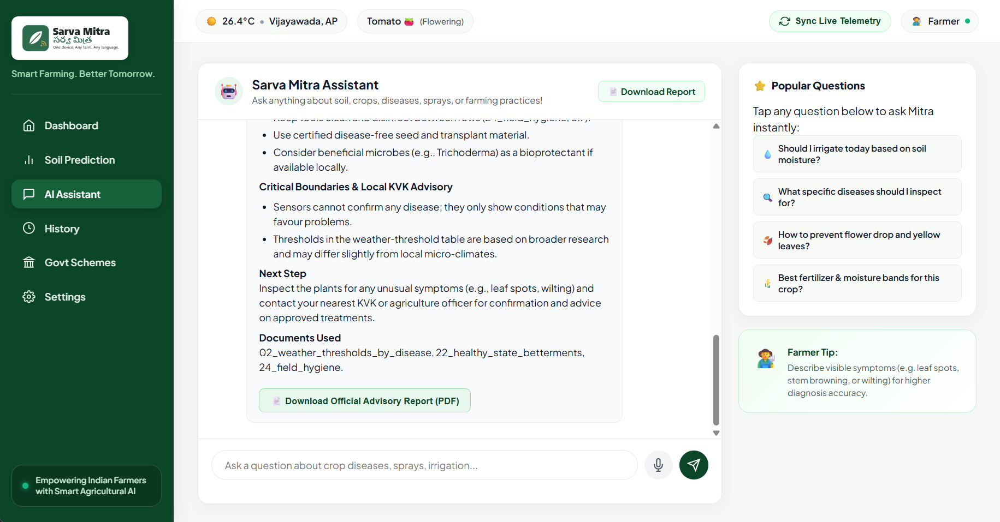
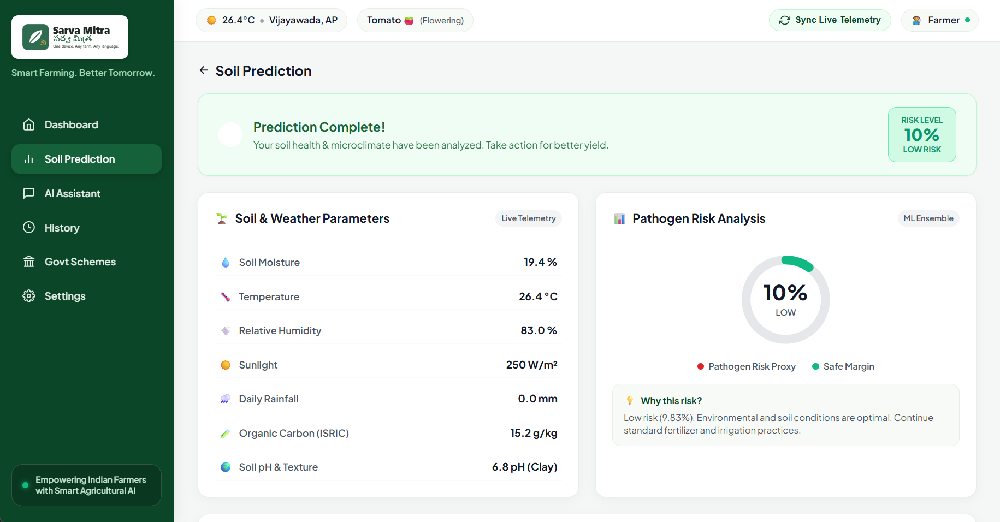
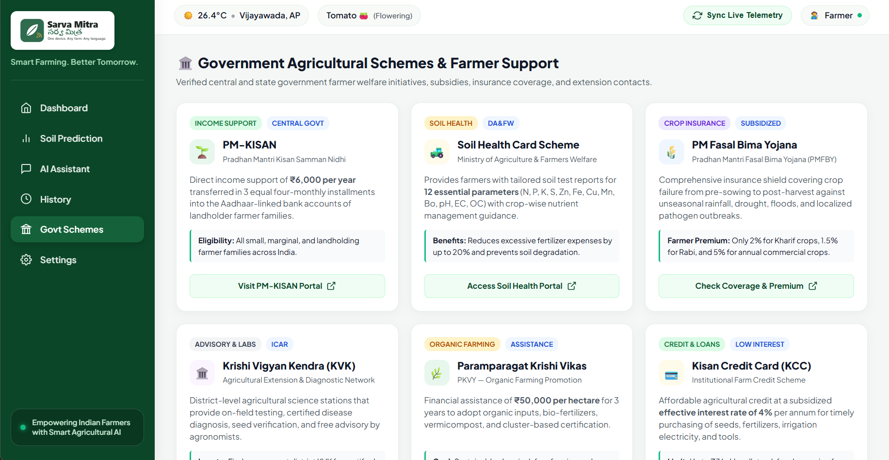
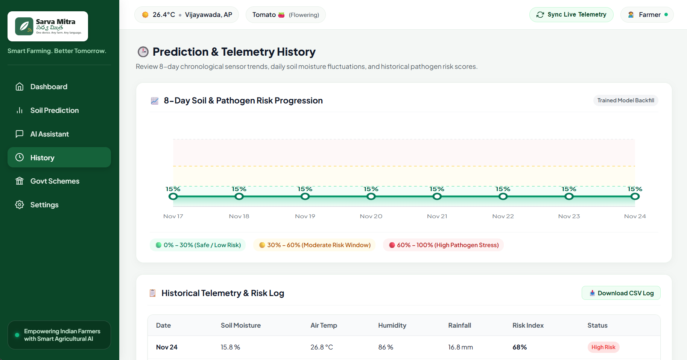
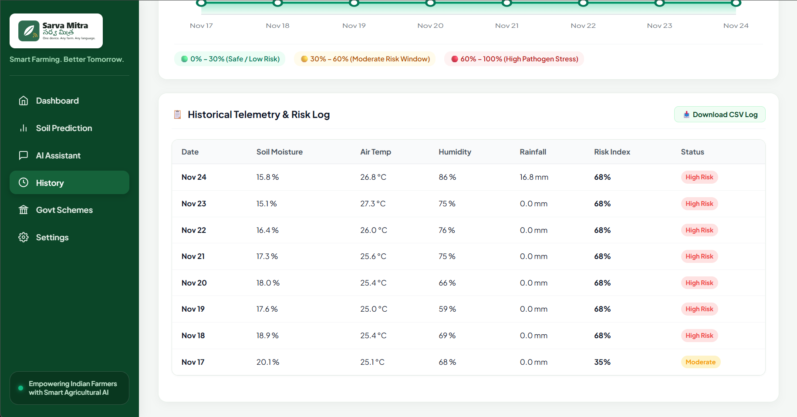
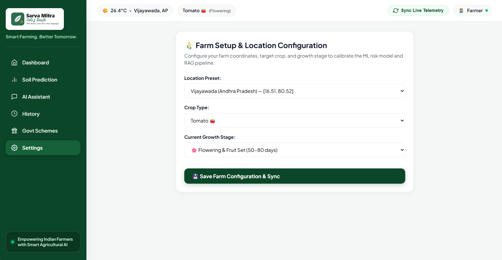

<div align="center">

# 🌱 SARVA MITRA (सर्व मित्र)
### *Universal Farm Companion — One Platform. Any Farm. Any Language.*

[](https://github.com/ByteCrunchers-HUB/SARVA-MITRA)
[](https://sarva-mitra-api.onrender.com/ui/)
[](https://sarva-mitra-api.onrender.com/docs)
[](https://www.python.org/)
[](https://fastapi.tiangolo.com/)
[](LICENSE)

**Developed with ❤️ by Team ANVEXA**

---

### 🌐 Quick Access Links
🚀 **Live Deployed Web Application:** [https://sarva-mitra-api.onrender.com/ui/](https://sarva-mitra-api.onrender.com/ui/)  
📂 **Official GitHub Repository:** [https://github.com/ByteCrunchers-HUB/SARVA-MITRA](https://github.com/ByteCrunchers-HUB/SARVA-MITRA)  
📖 **Interactive Swagger API Documentation:** [https://sarva-mitra-api.onrender.com/docs](https://sarva-mitra-api.onrender.com/docs)  
⚙️ **Automated Setup Guide:** [SETUP.md](SETUP.md)  
📄 **Sample Downloadable Advisory Report:** [sample_advisory_report.pdf](outputs/sample_advisory_report.pdf)

---

</div>

## 🚜 What is Sarva Mitra?

Farmers across the globe face relentless challenges: abrupt weather swings, late discovery of crop diseases, soil nutrient depletion, and language barriers in accessing scientific agricultural guidance. 

**Sarva Mitra (*"friend of all"* / *सर्व मित्र*)** solves this by uniting hyper-local environmental data, machine learning risk engines, and a grounded **Retrieval-Augmented Generation (RAG)** agricultural advisory into a single continuous feedback loop.

### 💡 Software Telemetry Architecture (Virtual Sensors)
To eliminate hardware failure points and provide immediate accessibility without costly physical sensor deployments (such as ESP32 or specialized probes), **Sarva Mitra integrates a Virtual Telemetry Layer**. It dynamically polls meteorological, satellite, and soil APIs for any farm coordinates globally, streaming continuous real-time and 8-day historical data straight into the ML and AI models.

---

## 📸 Output & Application Showcase

Here are live screenshots of the Sarva Mitra platform across key modules and user workflows:

### 1. 📊 Farmer Command Center & Live Telemetry Dashboard
*Real-time ambient temperature, humidity, soil moisture %, rainfall, and solar radiation paired with 8-day historical trends.*


---

### 2. 🤖 Continuous Agronomic AI Assistant (RAG Chat)
*Context-aware multi-turn conversational AI grounded in soil science and crop disease knowledge, offering instant diagnostic suggestions.*


---

### 3. 🧠 Machine Learning Risk Engine & Crop Diagnostics
*8-day consecutive trend anomaly detection calculating proactive disease and weather stress risk indices (Low / Moderate / High).*


---

### 4. 🏛️ Government Schemes & Agricultural Subsidies Explorer
*Direct access to official central and state agricultural support schemes, subsidies, insurance, and benefits.*


---

### 5. 📈 8-Day Historical Telemetry & Trend Analytics
*Detailed retrospective tracking of soil hydration, precipitation, temperature, and leaf wetness cycles.*

| Historical Telemetry Metrics | Historical Trend Graphs |
|:---:|:---:|
|  |  |

---

### 6. ⚙️ Farm Profile & Coordinate Configuration
*Customizable farm parameters, coordinate management, crop presets (Tomato, Chilli, Ragi), and API telemetry source selectors.*


---

### 7. 📄 Automated Advisory PDF Report
*Farmers can generate and download comprehensive agronomic field reports with one click.*  
👉 **[Download Sample PDF Advisory Report](outputs/sample_advisory_report.pdf)**

---

## 🧩 System Architecture

```text
       ┌────────────────────────────────────────────────────────┐
       │             Virtual Telemetry Service                  │
       │  (Open-Meteo, WeatherAPI, Tomorrow.io, AgroMonitoring) │
       └───────────────────────────┬────────────────────────────┘
                                   │
                     [Live & 8-Day Historical Telemetry]
                                   │
                                   ▼
       ┌────────────────────────────────────────────────────────┐
       │              ML Weather Risk Engine                    │
       │   (8-day consecutive trend anomaly & risk scoring)     │
       └───────────────────────────┬────────────────────────────┘
                                   │
                      [Risk % & Signal (Low/Mod/High)]
                                   │
                                   ▼
       ┌────────────────────────────────────────────────────────┐
       │            RAG Agronomic Advisory Pipeline             │
       │    (MongoDB Atlas Vector Search + Groq gpt-oss-120b)   │
       └───────────────────────────┬────────────────────────────┘
                                   │
            ┌──────────────────────┼──────────────────────┐
            ▼                      ▼                      ▼
 ┌──────────────────────┐┌──────────────────────┐┌──────────────────────┐
 │   Modern Web App     ││  Streamlit Web UI    ││  Unified REST API    │
 │  (/ui/ HTML5/CSS/JS) ││  (frontend/app.py)   ││  (FastAPI Backend    │
 │  Hosted on Render    ││  Interactive Cards   ││   & Swagger /docs)   │
 └──────────────────────┘└──────────────────────┘└──────────────────────┘
```

---

## 📂 Repository Structure

```text
SARVA-MITRA/
├── backend/
│   ├── main.py                    # Unified FastAPI Server (Serves API & Web UI at /ui/)
│   ├── telemetry_service/         # Multi-API virtual sensor telemetry engine
│   │   ├── service.py             # Telemetry aggregation & payload builders
│   │   ├── app.py                 # Standalone microservice endpoints
│   │   └── README.md              # Telemetry service documentation
│   ├── ml_engine/                 # LightGBM/ensemble disease & weather risk model
│   │   ├── backend.py             # ML inference engine & schema validation
│   │   ├── models/                # Trained model weights & static feature tables
│   │   └── README.md              # ML engine documentation
│   ├── rag_pipeline/              # MongoDB vector search + Groq LLM advisory
│   │   ├── rag.py                 # Dual-mode RAG retrieval & LLM generation
│   │   ├── ingest.py              # Agricultural document embedder & chunker
│   │   ├── PIPELINE_GUIDE.md      # Detailed RAG pipeline guide
│   │   └── docs/                  # Corpus of crop pathology & agronomy guides
│   ├── tests/                     # Integration and verification test suites
│   │   └── test_unified.py        # End-to-end pipeline test (Telemetry ➔ ML ➔ RAG)
│   └── README.md                  # Backend architecture documentation
├── frontend/
│   ├── web/                       # Modern responsive Web Application
│   │   ├── index.html             # Single-page dashboard markup
│   │   ├── styles.css             # Agricultural theme styling
│   │   └── app.js                 # Dynamic UI controller & API connectors
│   ├── app.py                     # Interactive Streamlit Web Dashboard
│   ├── src/                       # Expo / React Native mobile application source
│   ├── Dockerfile                 # Frontend deployment container
│   └── README.md                  # Frontend development guide
├── outputs/                       # Application screenshots & sample PDF report
│   ├── webapp_dashboard.png       # Live farmer dashboard
│   ├── webapp_aiassistant.png     # RAG conversational AI
│   ├── webapp_prediction.png      # ML risk prediction
│   ├── webap_govtshcemes.png      # Schemes explorer
│   ├── webapp_history_one.png     # Historical telemetry metrics
│   ├── webapp_history_two.png     # Historical trend graphs
│   ├── webapp_settings.png        # Settings panel
│   └── sample_advisory_report.pdf # Sample generated advisory report
├── requirements.txt               # Unified project dependencies
├── setup.sh                       # 1-click setup script (Linux/macOS/WSL)
├── setup.bat                      # 1-click setup script (Windows)
├── SETUP.md                       # Comprehensive setup and installation guide
├── render.yaml                    # Infrastructure-as-code for Render deployment
└── .env                           # Environment keys and database credentials
```

---

## ⚡ Quickstart & Installation

For full installation details, see [SETUP.md](SETUP.md).

### 1. One-Click Setup

**On Linux / macOS / WSL:**
```bash
chmod +x setup.sh
./setup.sh
```

**On Windows:**
```cmd
setup.bat
```

### 2. Manual Setup

```bash
# Clone the repository
git clone https://github.com/ByteCrunchers-HUB/SARVA-MITRA.git
cd SARVA-MITRA

# Create and activate virtual environment
python3 -m venv .venv
source .venv/bin/activate       # On Windows: .venv\Scripts\activate

# Install dependencies
pip install --upgrade pip
pip install -r requirements.txt
```

### 3. Configure `.env`

Create a `.env` file in the root directory:

```dotenv
# MongoDB Atlas Vector Search
MONGODB_URI="your_mongodb_atlas_connection_string"
MONGODB_DATABASE=soil-rag-db
MONGODB_COLLECTION=soil-rag-collection
MONGODB_VECTOR_INDEX=rag_vector_index

# Groq LLM API
GROQ_API_KEY="your_groq_api_key"
GROQ_MODEL="openai/gpt-oss-120b"

# Telemetry APIs
WEATHERAPI_KEY="your_weatherapi_key"
TOMORROW_IO_API_KEY="your_tomorrow_io_key"
AGROMONITORING_API_KEY="your_agromonitoring_key"
OPENWEATHERMAP_API_KEY="your_openweather_key"

# ML Model Paths
SARVA_MODEL_PATH=backend/ml_engine/models/sarva_mitra_risk_model.joblib
SARVA_STATIC_PATH=backend/ml_engine/models/static_features.csv
```

---

## 🚀 Running the Services

### 🌟 1. Unified FastAPI Server & Web App (Recommended)
Runs the unified backend and automatically serves the responsive Web UI:

```bash
uvicorn backend.main:app --host 0.0.0.0 --port 8000 --reload
```
* 🌐 **Web UI:** [http://localhost:8000/ui/](http://localhost:8000/ui/)
* 📚 **Interactive Swagger API Docs:** [http://localhost:8000/docs](http://localhost:8000/docs)
* 📑 **ReDoc Documentation:** [http://localhost:8000/redoc](http://localhost:8000/redoc)

### 🌿 2. Streamlit Web UI
Launches the interactive dashboard with telemetry cards and chat:

```bash
streamlit run frontend/app.py
```
* 🖥️ **Streamlit UI:** [http://localhost:8501](http://localhost:8501)

### 📱 3. Expo Mobile Application
Run the mobile app locally:

```bash
cd frontend
npm install
npx expo start
```

---

## 📡 Core API Endpoints

| Endpoint | Method | Description |
|---|:---:|---|
| `/ui/` | `GET` | Web Application Dashboard (HTML/CSS/JS) |
| `/api/dashboard` | `GET` | Aggregated dashboard: live telemetry, 8-day trends, ML risk, and quick advice |
| `/api/chat` | `POST` | Stateful agricultural Q&A assistant injecting live telemetry and ML risk into RAG |
| `/api/report/generate` | `POST` | Generates a formatted downloadable PDF agronomic advisory report |
| `/api/health` | `GET` | Comprehensive health check for Telemetry, ML Engine, and Vector DB |
| `/api/telemetry/*` | `GET` | Granular telemetry routes (`/current`, `/history`, `/ml-payload`, `/rag-payload`) |
| `/api/ml/*` | `POST` | Direct access to ML engine risk prediction |
| `/api/rag/*` | `POST` | Direct access to agricultural advisory generation |

---

## 🧪 Testing

Execute the end-to-end integration test validating the entire pipeline (Telemetry ➔ ML ➔ RAG):

```bash
SARVA_MODEL_PATH=backend/ml_engine/models/sarva_mitra_risk_model.joblib PYTHONPATH=. python backend/tests/test_unified.py
```

---

## ☁️ Cloud Deployment

The platform is deployed live on Render:
- 🌐 **Live Web Application:** [https://sarva-mitra-api.onrender.com/ui/](https://sarva-mitra-api.onrender.com/ui/)
- 📖 **Live Swagger UI:** [https://sarva-mitra-api.onrender.com/docs](https://sarva-mitra-api.onrender.com/docs)

Deploying your own instance is straightforward using the included [`render.yaml`](render.yaml) blueprint:
1. Fork or push to GitHub.
2. In the [Render Dashboard](https://dashboard.render.com/), choose **New +** ➔ **Blueprint**.
3. Select your repository.
4. Supply your secret environment variables (`GROQ_API_KEY`, `MONGODB_URI`, `WEATHERAPI_KEY`, etc.).
5. Click **Apply** to deploy both the API and Web UI.

---

## 👥 Credits & Team ANVEXA

Sarva Mitra was designed and engineered with dedication by **Team ANVEXA**:

| Team Member | Project Role & Contribution |
|---|---|
| 🌟 **Teja Sai Gudla** | Managing backend, database, APIs, and ML integration.  |
| 🌟 **PRIYANSHU SARMA** | RAG Advisory Pipeline, LLM Integration, Vector Search |
| 🌟 **LIBERATOR NYADUNDU** | Machine Learning Risk Engine & Weather Anomaly Scoring |
| 🌟 **RYALI VENKATA SRI VIJAY KARTHIK** | Full-Stack Integration, Unified FastAPI Backend & Web UI |
| 🌟 **Gajulapalli Venkata Raviteja** | Virtual Telemetry Layer & Meteorological Sensor Pipelines |
| 🌟 **Sneha Sarma** | Frontend Dashboard, UI/UX Design & Testing Validation |

* **Organization / Team:** **Team ANVEXA**
* **Repository:** [ByteCrunchers-HUB/SARVA-MITRA](https://github.com/ByteCrunchers-HUB/SARVA-MITRA)
* **Deployed URL:** [https://sarva-mitra-api.onrender.com/ui/](https://sarva-mitra-api.onrender.com/ui/)
