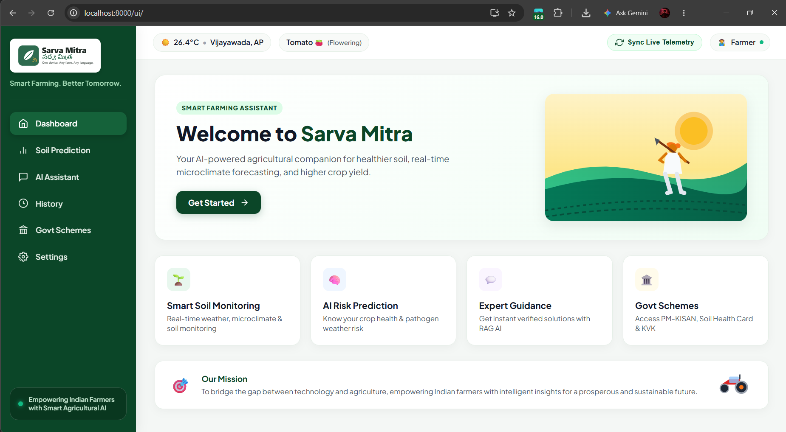
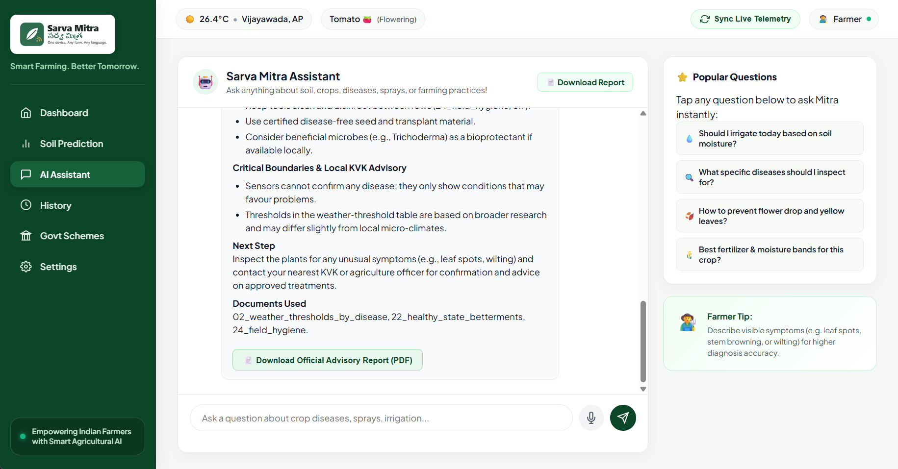
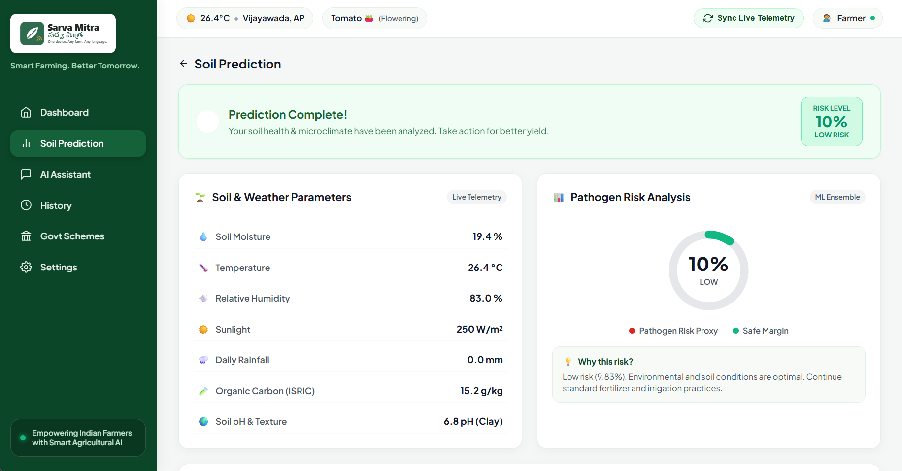
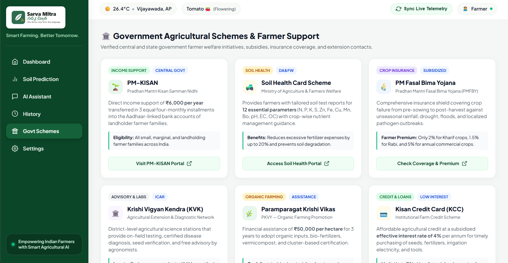

# 🌱 Sarva Mitra — Frontend Client Suite

The `frontend` directory contains the presentation tier of Sarva Mitra, providing three distinct user experiences:
1. **Modern Responsive Web UI (`frontend/web/`)**: HTML5, CSS3, and JavaScript web dashboard served natively by FastAPI at `/ui/`.
2. **Interactive Streamlit Web Dashboard (`frontend/app.py`)**: Instant diagnostic dashboard for testing telemetry, risk indices, and conversational RAG.
3. **Cross-Platform Mobile Application (`frontend/src/`)**: React Native & Expo mobile application with offline-friendly UI patterns.

---

## 📌 Project Links

* **GitHub Repository:** [https://github.com/ByteCrunchers-HUB/SARVA-MITRA](https://github.com/ByteCrunchers-HUB/SARVA-MITRA)
* **Live Deployed Web Application:** [https://sarva-mitra-api.onrender.com/ui/](https://sarva-mitra-api.onrender.com/ui/)
* **Backend API Documentation:** [https://sarva-mitra-api.onrender.com/docs](https://sarva-mitra-api.onrender.com/docs)
* **Full Setup Instructions:** [SETUP.md](../SETUP.md)

---

## 📸 Screenshots Showcase

| Farmer Dashboard | Agronomic AI Assistant |
|:---:|:---:|
|  |  |

| ML Risk Prediction | Government Schemes Explorer |
|:---:|:---:|
|  |  |

---

## 🌐 1. Modern Web Application (`frontend/web/`)

Located in `frontend/web/`, this single-page dashboard communicates directly with the unified FastAPI backend.

### Features:
- 📍 **Preset & Custom Farm Geolocation**: Instant coordinate selection for Vijayawada, Bengaluru, Guntur, Kurnool, Anantapur, and Hyderabad.
- 📡 **Live Telemetry Gauges**: Real-time cards for Temperature, Relative Humidity, Soil Moisture %, Precipitation, and Solar Irradiance.
- 🚨 **Risk Meter**: Color-coded risk alerts (Low 🟢 / Moderate 🟡 / High 🔴).
- 💬 **Multi-Turn Agricultural Chat**: Context-aware dialogue with quick-action chips.
- 🏛️ **Government Subsidies Directory**: Curated schemes for crop loans, micro-irrigation, and insurance.
- 📄 **Advisory PDF Generator**: One-click generation and download of formatted reports.

### Running:
The web app is hosted automatically by running the backend:
```bash
uvicorn backend.main:app --host 0.0.0.0 --port 8000 --reload
```
Open **[http://localhost:8000/ui/](http://localhost:8000/ui/)** in your browser.

---

## 🌿 2. Streamlit Web UI (`frontend/app.py`)

A rapid prototyping interface written in Python.

### Running Streamlit:
From the project root:
```bash
streamlit run frontend/app.py
```
Open **[http://localhost:8501](http://localhost:8501)** in your browser.

---

## 📱 3. Mobile Application (Expo / React Native)

A cross-platform mobile experience located in `frontend/` (using `src/app/` Expo Router).

### Local Setup:
```bash
cd frontend
npm install
npx expo start
```

Configure your API endpoint in `frontend/.env`:
```bash
EXPO_PUBLIC_API_BASE_URL=http://localhost:8000
```
> For Android Emulator use `http://10.0.2.2:8000`; for physical phones use your machine's LAN IP.

### Code Quality Verification:
```bash
npx tsc --noEmit
npx expo lint
npx expo-doctor
```

---

## 👥 Credits — Team ANVEXA

* **PRIYANSHU SARMA**
* **LIBERATOR NYADUNDU**
* **RYALI VENKATA SRI VIJAY KARTHIK**
* **Gajulapalli Venkata Raviteja**
* **Sneha Sarma**

**Repository:** [https://github.com/ByteCrunchers-HUB/SARVA-MITRA](https://github.com/ByteCrunchers-HUB/SARVA-MITRA)  
**Live Web Application:** [https://sarva-mitra-api.onrender.com/ui/](https://sarva-mitra-api.onrender.com/ui/)
